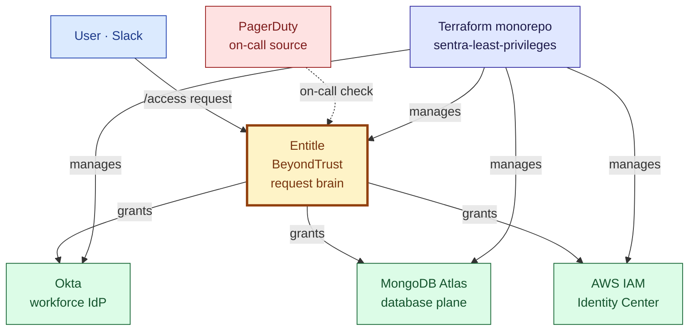
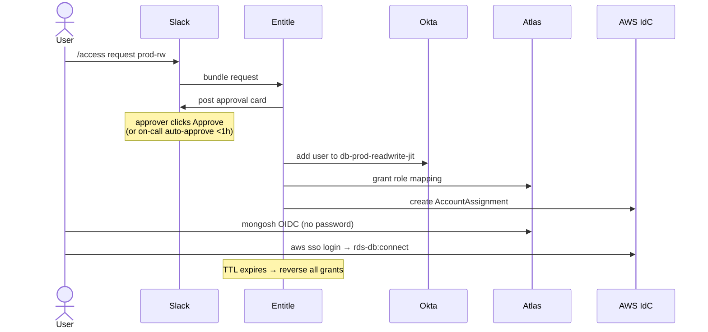

<!-- SLIDE: title icon=🔐 -->
# Sentra Least-Privileges
# Five Systems · Five Auth Methods
**Oren Sultan** | Senior DevOps & Platform Engineer | Tikal | DevOps Brief · 2026-06-30

<!--
speaker: This is the DevOps internal version of the least-privileges talk. We'll walk five SaaS systems we touch, then go one slide per authentication mechanism our IaC layer uses to manage them, and finish with a real end-to-end request flow. No R&W methodology, no ADR walkthrough — pure implementation focus.
-->

<!-- SLIDE: bullets -->
## About me

- **Oren Sultan** · Senior DevOps / Platform Engineer @ Tikal
- **15 years** across infrastructure and platform engineering
- **Kubernetes · ArgoCD · Crossplane · Platform Engineering · SRE**

<!--
speaker: Quick credibility moment — twenty seconds at most. Move on.
-->

<!-- SLIDE: problem -->
## 🚨 Where we started

- **~25 services share 1 RDS master password**
- **5 services + CDC share 1 atlasAdmin user**
- **No per-actor audit trail in either DB**
- **No revocation under 24 hours**

> One compromised pod → full admin on **all** customer data.

<!--
speaker: This is the current-state we are migrating away from. Set the stakes in 60 seconds: shared admin creds, zero attribution, slow revocation, SOC2 gap. Don't dwell — the next slide answers it.
-->

<!-- SLIDE: divider -->

# The Solution

## Five SaaS systems collaborate

<!--
speaker: From here we walk what's in production today.
-->

<!-- SLIDE: diagram type=context -->
## Five SaaS systems answer it

> Four of five are managed from one Terraform repo. PagerDuty is the exception.

<!--
speaker: This is the anchor slide. Point at each node, name its role, point out that PD is sitting off to the side because it is the only system not managed from the sentra-least-privileges TF repo. Spend two minutes here. Everything in the rest of the deck hangs off this.
-->

<!-- SLIDE: divider -->

# Auth Methods

## One slide per mechanism

<!--
speaker: From here we walk one slide per IaC-to-SaaS authentication pattern.
-->

<!-- SLIDE: comparison -->
## Auth 1 · AWS — GHA OIDC → IAM Role

::left::

### The mechanism

- GitHub Actions OIDC issues short-lived JWT
- AWS trusts `token.actions.githubusercontent.com` as OIDC IdP
- `sts:AssumeRoleWithWebIdentity` exchanges JWT for STS creds

::right::

### The wiring

- IAM role `CrossplaneIdentityCenterAdmin`
- Trust pins repo `sentraio/sentra-least-privileges` + ref `main`
- **No GHA Secrets used for AWS — pure federation**

<!--
speaker: Best-case auth: no static keys, JWTs minted per run, expire in fifteen minutes, every assume-role logged in CloudTrail. The IAM role is multi-trusted — same role is also assumed by IRSA from platform-tools EKS for Crossplane workloads, and by AWS SSO humans for local terraform apply. One role, three trust paths.
-->

<!-- SLIDE: comparison -->
## Auth 2 · Okta — OAuth + private JWK

::left::

### The mechanism

- Okta API Services app (no human in flow)
- Client auth = `private_key_jwt`
- TF signs JWT; Okta verifies vs public JWK
- Bearer token returned, scoped

::right::

### Used in TWO places

- **TF service app** `Crossplane` (0oa13mcky9z2aeC9m698)
- **Entitle's API Services app** (we provision it)
- Same flow · different consumer
- Local PEM + GHA secret

<!--
speaker: Notice the reuse — the same private-key-jwt flow is used by Terraform to talk to Okta and by Entitle to call Okta back. We provision Entitle's Okta API Services app from our okta module. Rotation means rotating the JWK pair and updating both the GHA secret and the app's registered public JWK. Scopes on the TF app: apps slash groups slash policies slash roles dot read manage, plus appGrants and users dot read.
-->

<!-- SLIDE: comparison -->
## Auth 3 · Atlas — API key pair

::left::

### The mechanism

- HTTP digest auth
- Public key = username
- Private key = password
- **ORG_OWNER required** for federation config
- No JWT, no short-lived token

::right::

### The wiring

- Local: `~/sentra/.atlas-federation-apikey.json`
- GHA: `ATLAS_FEDERATION_PUBLIC_KEY` + `_PRIVATE_KEY`
- Provider config: `public_key` + `private_key`
- **Rotation gap** — no automated policy

<!--
speaker: Atlas is the simplest auth method but also the broadest scope. ORG_OWNER is required to manage federation config — federation lives at the org level, not the project level, so a project-scoped key is insufficient. The rotation gap is real — slide 11 picks it up.
-->

<!-- SLIDE: comparison -->
## Auth 4 · Entitle — PAT plus two more

::left::

### TF → Entitle: API PAT

- Bearer token (PAT)
- `Authorization: Bearer <PAT>`
- Endpoint: `api.us.entitle.io`
- Local: `~/sentra/beyondtrust/.entitle-pat`
- GHA: `ENTITLE_API_KEY`

::right::

### Entitle → Slack + Okta (pass-through)

- **Slack bot token** (`ENTITLE_SLACK_BOT_TOKEN`)
- **Okta private JWK** (`ENTITLE_OKTA_PRIVATE_JWK`)
- Same private_key_jwt as slide 6
- Three creds total in the GHA matrix

<!--
speaker: This is the "why three creds for one SaaS?" moment. Entitle itself takes a PAT. But its Slack integration and Okta integration each need their own credential — bot token for Slack, JWK for Okta — and TF passes both through. The Okta JWK is the link back to slide 6: same mechanism, different consumer.
-->

<!-- SLIDE: comparison -->
## Auth 5 · PagerDuty — API token, two controllers

::left::

### Same mechanism, two consumers

- API token: `Authorization: Token token=...`
- **Crossplane** `provider-pagerduty` on `platform-tools` EKS
  → Schedules · ScheduleLayer · ScheduleOverride
- **Pulumi** `sentra-infrastructure/pagerduty_provision`
  → 80+ Services + escalation policies

::right::

### Where each token lives

- Crossplane: K8s Secret on platform-tools
- Pulumi: stack config (`token.secure`)
- Datadog: read-only PD key (separate)
- **PD is NOT in `sentra-least-privileges`**

<!--
speaker: Yes — two IaC tools for one SaaS. Yes — on purpose. ADR-009 scoped Crossplane to the on-call schedule surface only. Pulumi owns the eighty-plus PD Services and escalation-policy bindings. Users, Teams, Integrations stay manual in the PD UI. The on-call schedule is the link that lets Entitle's break-glass workflow auto-approve prod RW for the current on-call engineer under one hour.
-->

<!-- SLIDE: divider -->

# Put it together

## A real prod-rw request

<!--
speaker: Now we tie all five auth methods into one user-facing flow.
-->

<!-- SLIDE: diagram type=sequence -->
## A real `prod-rw` request, end-to-end

> Slack → Entitle → grants land in 30 seconds. Every auth method from slides 5-9 fires.

<!--
speaker: This is the aha slide. Step three fires the Okta JWK from slides 6 and 8. Step five fires the AWS GHA OIDC chain from slide 5 in reverse — Entitle has its own AWS integration credential, but the user ends up at the same IdC PermissionSet. The TTL teardown at the bottom is symmetric — Entitle reverses every grant in reverse order. Spend two minutes here.
-->

<!-- SLIDE: bullets -->
## Open items

- 🟡 **Atlas key rotation** — ORG_OWNER pair has no automated policy
- 🟡 **PR #11** — finalise Entitle `db-rw` `allowedDurations`
- 🟠 **Legacy `charts/` cleanup** — argocd ApplicationSet still points at superseded Crossplane Helm
- 🟠 **PD rationalisation** — Crossplane vs Pulumi split worth revisiting
- 🔴 **Destroy guardrails** — `prevent_destroy` on IdP + workflows + Okta service app

<!--
speaker: Frame these as next week's PRs, not things keeping me up at night. The red item is the only real risk — losing the Crossplane Okta service app would lock TF out of Okta entirely. Worth a prevent_destroy on the app itself.
-->

<!-- SLIDE: bullets -->
## What's next

- **Atlas key rotation runbook** + Entitle bundle for the operator
- **Tear down legacy `charts/`** + argocd ApplicationSet
- **Destroy guardrails** + per-resource `prevent_destroy`
- **PD rationalisation** — evaluate consolidating to one IaC
- **Beyond v1**: Atlas Workload Identity Federation for services

<!--
speaker: End on the v2 ambition. Workload Identity Federation for service-to-Atlas would close the loop — no stored Atlas passwords for pods either. Story 70394 (okta_assign_db_admins.py) is also un-cancelled per ADR-001 Pattern C reinstatement.
-->

<!-- SLIDE: thank-you -->
# Thank You
## Questions?

**Oren Sultan** · github.com/sentraio/sentra-least-privileges · #devops

<!--
speaker: Take Q&A. If asked about R&W or the AD, point at the high-level deck at blog slash presentations slash least-privileges-high-level — that's the CTO-scope framing.
-->
